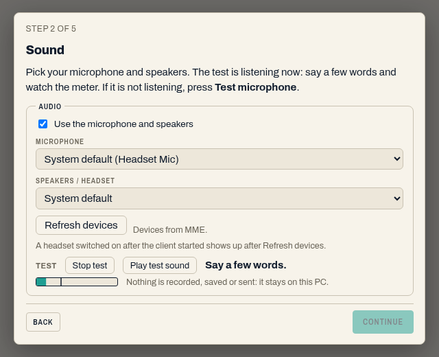
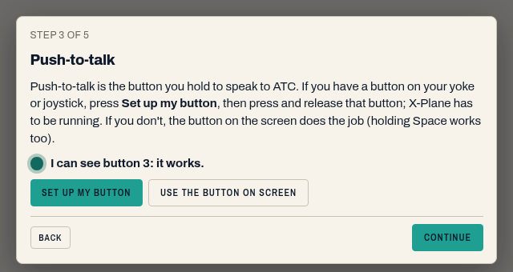
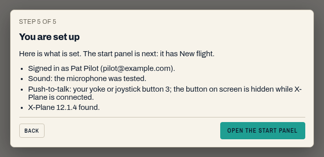

# Install and sign in

SeventyOneTen has two parts. The controller runs in the cloud. On your sim PC you run a small program, the **client**, in its own window beside X-Plane. It reads your aircraft's state from X-Plane, sends your voice while you hold push-to-talk, and plays ATC's replies through a radio effect.

## What you need

| | |
|---|---|
| Simulator | X-Plane 12.1.4 or newer. The client uses X-Plane's own Web API, and needs the version of it that arrived in 12.1.4. Tested on 12.4.3. Use the current X-Plane 12 release |
| PC | Windows 10 or 11. The window uses Edge WebView2, which ships with both. On Linux, see [Install on Linux](install-linux.md). On an Apple silicon Mac with macOS 14 or newer, see [Install on a Mac](install-mac.md) |
| Audio | A microphone, and speakers or a headset |
| Account | A SeventyOneTen account, created for you by the project owner |
| The client | The installer (Windows), the AppImage (Linux) or the disk image (Mac), from the pilot site once you are signed in (below) |
| Phone | An authenticator app, for the sign-in's second step |

!!! note "Invitation only"
    SeventyOneTen is an experiment and is not open for sign-up. If you were invited, the owner has sent you an email with a temporary password.

## Install (one time)

These steps are for Windows. On Linux, follow [Install on Linux](install-linux.md); on a Mac, follow [Install on a Mac](install-mac.md). Then come back here to sign in.

1. Go to the pilot site, [app.7110atc.com](https://app.7110atc.com), and sign in with your SeventyOneTen account. Open **Download** (<https://app.7110atc.com/#/download>) and press **Download for Windows**. The file is `SeventyOneTen-setup-<version>.exe`.
2. Run it. It installs for your Windows account only and does not ask for an administrator password.
3. The installer is not signed yet, so Windows may say "Windows protected your PC". Choose **More info**, then **Run anyway**. Do this only for a file you downloaded from the Download page while signed in.
4. Open **SeventyOneTen** from the Start menu (or from the last page of the installer). The first time, it walks you through [setting up](#set-up-the-first-time).
5. Allow the microphone: *Windows Settings > Privacy & security > Microphone > Let desktop apps access your microphone*.

There is nothing else to install and no keys to copy. You sign in from the window.

!!! note "Installed it before 20 October 2026? Reinstall once, by hand"
    On 2026-10-20 the pilot site moved to [app.7110atc.com](https://app.7110atc.com) (the product's home is [7110atc.com](https://7110atc.com)). Client 0.19.0, and any client older than **0.20.0-rc.11**, looks for updates at the old address, so it can no longer find them or sign in: download the newest installer from [app.7110atc.com/#/download](https://app.7110atc.com/#/download) and run it over your copy. After that, updates arrive by themselves again.

The installed app updates itself: see [Updates](settings.md#updates). To remove it, use *Windows Settings > Apps > SeventyOneTen > Uninstall*. Your settings and log stay in `%LOCALAPPDATA%\xatc-agent-client` until you delete that folder. Your sign-in stays in Windows Credential Manager until you press **Sign out** in the window; do that before uninstalling if you want it gone.

## Start the client

Open **SeventyOneTen** from the Start menu. The **SeventyOneTen client** window opens. The very first time, it opens the setup, described next. On every start after that, it opens the startup dialog: one row each for your sign-in, the ATC service and X-Plane. There is no console window; the [log file](settings.md#where-things-are-kept) holds what a console would show.

- X-Plane is shown but not required yet. Start it whenever you like; the client keeps looking for it.
- Only one client runs at a time. Starting it again brings the window that is already open to the front.

## Set up the first time

The first time you open SeventyOneTen, a dialog called **Set up SeventyOneTen** takes you through five steps, one at a time: **Step 1 of 5** and so on, with **Back** to return. A first setup cannot be closed before the last step. If you quit before the end, it opens again the next time you start.

1. **Sign in.** Press **Sign in**. Your browser opens the SeventyOneTen sign-in page (see [Sign in](#sign-in) below). The setup moves on by itself once you are signed in. This step cannot be skipped: ATC needs your account. If the sign-in does not finish, the step says why, and **Cancel sign-in** lets you stop it and try again.
2. **Sound.** Pick your microphone and your speakers or headset. The test is already listening: say a few words and watch the level meter. When the client hears you, the line says **We can hear you** and **Continue** opens. Press **Play test sound** to hear a short sound through your speakers. If nothing is heard after about 20 seconds, **Continue without testing** appears, so a missing microphone does not trap you here; you can test later in [Settings](settings.md#test). Nothing is recorded, saved or sent: it stays on this PC.
3. **Push-to-talk.** Push-to-talk is the button you hold to speak to ATC. If you have a button on your yoke or joystick, press **Set up my button**, then press and release that button; X-Plane has to be running. The client then asks you to hold it down, and a light turns on when it sees the button: **I can see button 3: it works** (with your button's number). If you have no such button, press **Use the button on screen**: the window has a button, and holding **Space** works too. You can change this later in [Settings](settings.md#push-to-talk).
4. **X-Plane.** The step says whether X-Plane was found. If not, start X-Plane 12 and check that its Web API is on. You can **Skip** this step: the client keeps looking for X-Plane.
5. **You are set up.** A short list of what is set. **Open the start panel** closes the setup and shows the [start panel](first-flight.md#start-a-flight), where **New flight** is.

If you set a yoke or joystick button, the button on the screen is hidden while X-Plane is connected, and a thin transmit light takes its place: see [Push-to-talk](settings.md#push-to-talk). If you skipped it, the button stays.

If you installed SeventyOneTen before this setup existed and updated, you do not see it. To go through it, open **Settings > About and support** and press **Run setup again**.

## Sign in

1. Press **Sign in** in the setup (or, later, in the startup dialog or the window's top bar). Your browser opens the SeventyOneTen sign-in page.
2. The first time, enter your email and the temporary password from your invitation, choose your own password, and set up your authenticator app. After that it is your email, your password and the authenticator's code (or a passkey, if you add one). **Passkeys must be added again** after the sign-in move of 2026-10-20: a passkey belongs to the sign-in address, so the old ones no longer work. Sign in with your password and the authenticator's code, then add the passkey again.
3. The browser says **Signed in** and you can close the tab. The window's sign-in pill turns green.

You stay signed in for 30 days, across restarts. In the last 24 hours the window offers **Sign in again**, which never interrupts a flight. The client keeps your sign-in in Windows Credential Manager (on a Mac, in your Keychain; on Linux, in your keyring), never in a file.

## Your sound and your address

ATC's address comes with your account. When you sign in, the client gets it. Under **Account**, Settings has a **Sign-in** part with one line about it, **ATC address**: **From your account.** once the client has it. If it says the address could not be fetched, press **Try again**.

The setup's Sound step is the same as **Settings > Sound**: your microphone, your speakers and the test. To change them later:

1. Open the **Settings** view and choose **Sound**.
2. Pick your microphone and your speakers or headset. **Test microphone** and **Play test sound** check them.
3. Press **Save** in the bar at the bottom of the window.

That is all the setup. [Settings](settings.md) describes everything else you can change, such as how the controllers sound (**Sound**) and push-to-talk on a yoke button (**Push-to-talk**).

## The recording question

The first time you connect, the window asks one thing before you can transmit:

> **Keep your radio audio to improve SeventyOneTen?** SeventyOneTen can keep recordings of what you say on the radio, to help it understand pilots better. Only your own transmissions are kept, in private storage, for 180 days. The owner and the ATC expert can listen to them. SeventyOneTen also keeps the text its speech recognizer wrote down for what you said, with your flight's record, for as long as that flight is kept: only the audio is deleted after 180 days. You can change this at any time in Settings. Your flight's transcript is always kept with the flight. The recording and the recognizer's own text are kept only if you allow it.

Choose **Allow** or **Don't allow**. Your choice is remembered with your account, and you can change it in **Settings > Account > Recording**. [Your data](privacy.md) says what else is sent and kept.

## Next

[Your first flight](first-flight.md).
