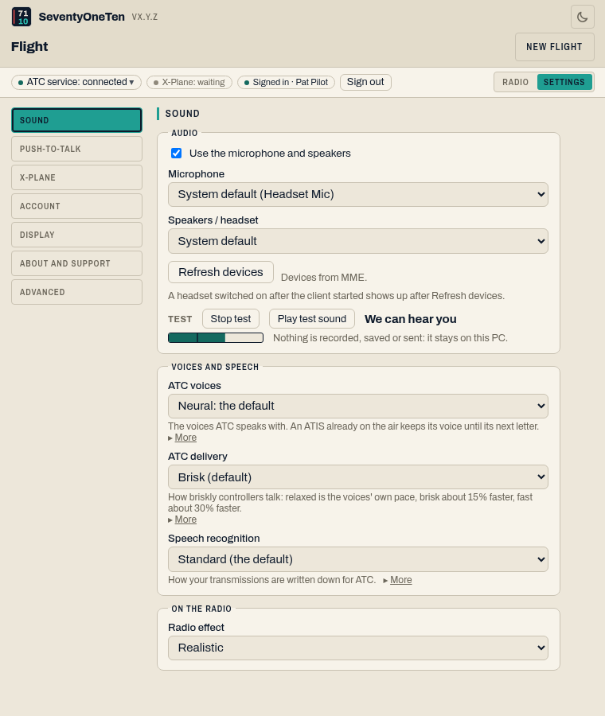
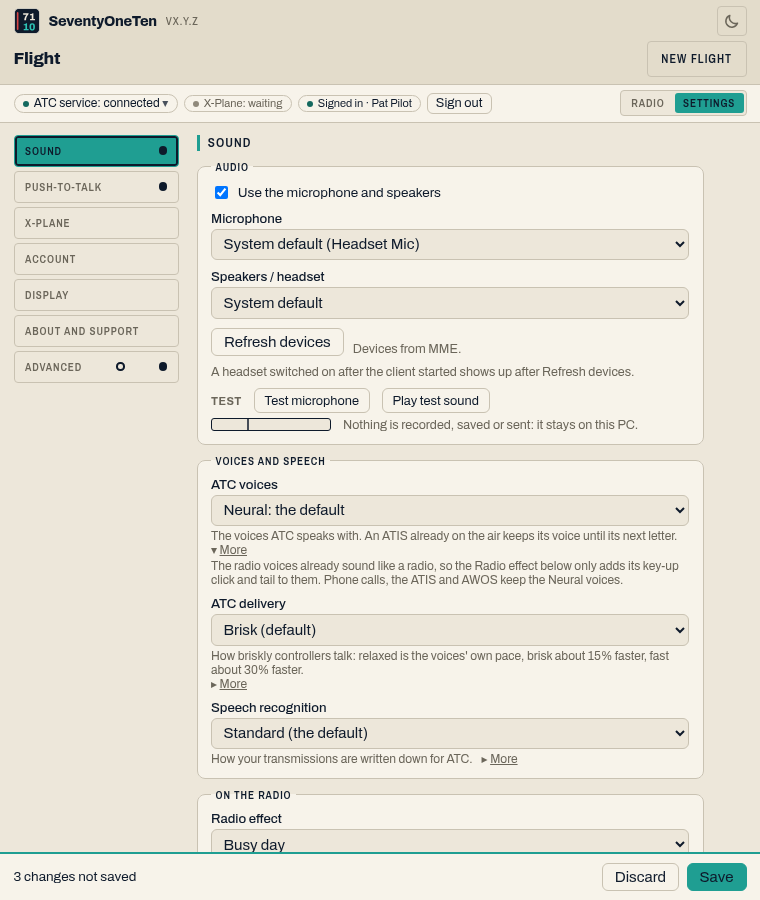
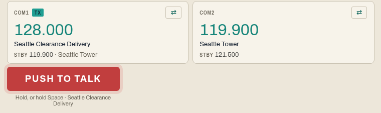
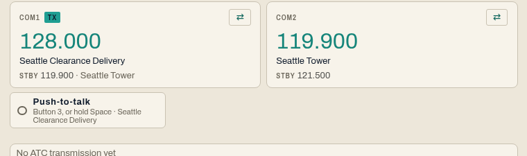

# Settings

Everything is configured on the window's **Settings** view. There are no command-line options to learn and no files to edit.

Settings shows one section at a time, picked from a list: **Sound**, **Push-to-talk**, **X-Plane**, **Account**, **Display**, **About and support** and **Advanced**. The list is down the left side of the window, or across the top when the window is narrow. The open section is marked. A dot beside a section's name means it has a change you have not saved. The section you opened last is remembered until you close the app.

!!! note "Some settings are shown only to some accounts"
    Which settings you see depends on your account. If a setting described on this page is not on your Settings page, your account does not show it, and ATC uses a standard value for it. The owner can show a setting to an account, for example while looking into a problem. Where a setting below is often hidden, the page says so.

## Saving

A bar at the bottom of the window appears as soon as you change something. It counts the changes ("1 change not saved", "3 changes not saved") and has **Discard** and **Save**, wherever you are on the page.

- **Save** checks every field first. A bad value is highlighted, its section opens, and nothing is saved. When it works the bar says **Saved** for a moment, and the window stays on Settings.
- **Discard** puts back what was last saved. Putting a field back by hand clears it from the count too.
- Changing section does not ask anything: the changes wait. Leaving Settings with changes (to **Radio**, say) asks **Leave Settings?** with **Save**, **Discard** and **Stay**.
- With a flight under way, some changes reconnect it. The bar says so when that is the case: **Saving reconnects your flight for a moment (same flight).** ATC finishes talking first. Save never starts a flight.
- A few controls act at once and are not counted: **Learn button**, **Allow** and **Don't allow**, **Install**, **Update** and **Remove** for the FAA data, **Check now**, **Test microphone** and **Play test sound**. The **Night**/**Paper** button in the header and the log's **Radio**/**Everything** choice save the moment you press them.

## Sound

What you hear and say: your microphone and speakers, and how ATC sounds.

### Audio

| Setting | What it is |
|---|---|
| **Use the microphone and speakers** | Off: no microphone and no sound, for testing |
| **Microphone**, **Speakers / headset** | Your devices, or **System default**. A headset switched on after the client started appears after **Refresh devices** |

### Test

The **Test** row checks your sound before you fly.

- **Test microphone** opens the microphone and shows a level meter. Say a few words: the line turns to **We can hear you** once the client has heard you for about half a second. **Stop test** ends it. It also stops by itself after a minute, when you press push-to-talk, when a flight starts, and when you leave Sound.
- **Play test sound** plays a short, two-second sound through your speakers, with the radio effect you chose. Use it to set your volume.
- Changing the microphone or the speakers while the test runs switches the test to that device. It does not save the change: **Save** does.
- During a flight the test listens to the microphone the flight uses, and the test sound is not played (ATC is using the speakers).
- **Nothing is recorded, saved or sent: it stays on this PC.** The test is not part of a flight and is never kept.

### Voices and speech

**ATC voices**, **ATC delivery** and **Speech recognition** are shown only to some accounts. If you do not see them, your account flies with the standard choices.

| Setting | Choices |
|---|---|
| **ATC voices** | The voices ATC speaks with. Four choices, in this order: *Radio voices: distinct controllers with accents*, then under **Standard voices**: *Standard: cheapest, most robotic*, *Neural: the default* and *Generative: most natural, about twice neural's cost, may be slightly slower to start*. Saving a change reconnects the flight (the same flight), so ATC switches at once; an ATIS already on the air keeps its voice until its next letter |
| **ATC delivery** | How briskly controllers talk: *Relaxed*, *Brisk* (the default, about 15% faster) or *Fast* (about 30% faster). The ATIS is always read at the relaxed pace. Saving a change reconnects the flight (the same flight) |
| **Speech recognition** | How your transmissions are written down for ATC. Two choices: *Standard (the default)* and *Scribe, which knows your flight's names*. Saving a change reconnects the flight (the same flight); it applies from your next transmission. If Scribe is not available on a flight, Settings says **Scribe is not available on this flight: speech recognition is Standard.** See [Your data](privacy.md#what-happens-to-your-voice) for where the audio goes |

### On the radio

| Setting | Choices |
|---|---|
| **Radio effect** | *Clean*, *Realistic* (the default) or *Busy day*: how much of a VHF radio you hear on ATC's voice |
| **Hear other traffic on the frequency** | Client 0.20 prerelease. A checkbox, off by default. On, you hear the [AI traffic](traffic.md#hearing-the-other-traffic)'s calls, and ATC's replies to them, on a frequency one of your radios is tuned to and set to listen to: never over you, nor over ATC talking to you. The row appears only when ATC offers it for your flights, and it matters only on a flight whose **Traffic** is not **None**. Saving a change reconnects the flight (the same flight) |

### The radio voices

The radio voices are off by default. With them on, each controller on the radio gets a distinct voice with an accent. Within a flight, one frequency keeps one voice. They already sound like a radio, so the **Radio effect** only adds its key-up click and tail to them. Push-to-talk phone calls, the ATIS and AWOS keep the Neural voices; the experimental [two-way call](#phone-calls) has its own live voice. If the radio voices are not available on a flight, the flight goes on with the standard voices, and Settings says so under the list.

## Push-to-talk

Holding **Space** on the Radio view always transmits. **Also transmit with** adds one more way:

| Choice | What it does |
|---|---|
| Only this window (button, or hold Space) | The button in the window, or hold Space while the window has focus |
| A yoke or joystick button, through X-Plane | Hold the button to transmit, wherever the focus is |

**The button in the window is hidden while a yoke or joystick button is set and X-Plane is connected.** A thin light takes its place: it says **Push-to-talk**, and **TRANSMITTING** while you are keyed, with your button's number and the station you are talking to under it. If X-Plane is not connected, the button comes back (a button set through X-Plane cannot key then), and it is always there when no button is set. Holding Space works either way. Setting up your button is part of the [first-run setup](getting-started.md#set-up-the-first-time).

| No button set, or X-Plane not connected | A button set, X-Plane connected |
|---|---|
|  |  |

For a yoke or joystick button, press **Learn button**, then press and release the button you want within 10 seconds. X-Plane must be running. The client reads the button through X-Plane, so anything X-Plane sees as a joystick button works. The client says "Learned button 5 and saved it" (with your button's number), and **Button index** shows it. To go back to the button in the window, set **Also transmit with** to **Only this window**.

(When you run the client from a console window, there is a third choice, **Enter in the console window (toggles)**. The installed app has no console, so it does not show it.)

### Phone calls

The last row of Push-to-talk is **Phone calls**. **Push to talk** is the default: on a [clearance call](features/clearance.md#by-phone-at-a-field-with-no-radio-way) you hold the key, as on the radio.

The two **Two-way (experimental)** choices, **Two-way A** and **Two-way B** (two versions of the same thing, being compared), open your microphone for the call: there is no button, you just talk, and ATC answers when you have finished. Use a headset. They are experimental and offered only on some accounts for now. When a flight does not offer one, its choice is greyed and calls stay push to talk. If a two-way call has trouble, it goes on as push to talk and the call screen says "Two-way calling stopped. Hold to talk to continue." The choice applies from your next call; saving it never reconnects the flight.

## X-Plane

### Connection and folder

The first line says whether the client found your X-Plane. Most accounts show the rows below; an account can have them hidden, and then the standard values are used.

| Setting | What it is |
|---|---|
| **Silence X-Plane's own ATIS and AWOS during a flight** | On by default. X-Plane has an ATIS and AWOS of its own on the same frequencies, so with both on you would hear two voices with two sets of weather. During a flight the client switches X-Plane's off and switches it back on when the flight ends. If you had it off already, it stays off |
| **X-Plane host** and **Web API port** | Where X-Plane's Web API listens. The default, `127.0.0.1` and `8086`, is right when the client runs on the same PC as X-Plane |
| **End the flight when X-Plane is closed for (s, 0 = never)** | Seconds. The default is 30. A pause or a stutter never ends a flight. `0` turns it off |
| **X-Plane folder** (optional) | Leave blank to use the folder X-Plane last ran from. The first line says "Reading" and the folder the client found, or that it found none |

### FAA procedures and ATC data for X-Plane

This part installs the FAA's current procedures into your X-Plane, and takes them out again, with **Check for update**, **Install**, **Update** and **Remove**. See [Your X-Plane's data](client/xplane-data.md#faa-procedures-for-your-x-plane).

## Account

### Sign-in

**Signed in as** shows who is signed in, with **Sign out** (or **Sign in** when you are not): the same as the button in the window's top bar.

| Line | What it is |
|---|---|
| **ATC address** | One line, not a field. ATC's address comes with your account when you sign in. The line says **From your account.** once the client has it, and **It comes from your account when you sign in.** until then. The window never shows the address itself. If it could not be fetched, the line says so and **Try again** is beside it |

### Recording

**Keep my radio audio to improve SeventyOneTen** shows your answer to the [recording question](privacy.md#recordings-of-your-voice), with **Allow** and **Don't allow** to change it. Your choice is saved with your account and takes effect at once. Recordings already kept stay until they expire. While it saves, a **Saving settings** box keeps you from leaving the page until the choice is saved.

### Updates

The installed app asks the pilot site for the newest version when it starts, and once a day while it is open. A newer version shows a banner above the views: **What changed**, **Update now** and **Later**. The banner waits until your flight has ended, and nothing is installed during a flight. **Update now** downloads the new version, checks it, installs it, and the app opens again by itself. On Windows it runs the installer; on Linux it replaces the AppImage file (see [Install on Linux](install-linux.md#updates)); on a Mac it replaces the app, which must be in Applications or another folder you can write to (see [Install on a Mac](install-mac.md#updates)). **Later** puts that version off until a newer one comes, or until you start the app again.

- **Check now** checks on request, and says if it could not.
- **Receive prereleases: early versions, to try before everyone gets them** is off unless you turn it on. On, you are offered early versions too. A prerelease is a build for testing; it can have faults, and a later change to the service can stop it working until you update. Turn it on only if you have been asked to.
- If ATC needs a newer client than yours, the banner says **Update required** and has no **Later**.

### App menu (Linux AppImage)

Only on Linux, and only when you run the AppImage, **Account** has one more part, **App menu**, with **Add to app menu** and **Remove from app menu**. See [Install on Linux](install-linux.md#add-the-app-to-your-app-menu). Nowhere else shows it.

## Display

| Setting | What it is |
|---|---|
| **Theme** | **Night** (the default) or **Paper**. The button at the top right of the window switches it too |
| **Show the Approach card: ATC's plan for your vectors and approach, as a diagram** | On by default. Off, the window never shows [ATC's approach plan](client/approach-card.md) as a card. The confirmation in the header still shows |
| **Log detail** | **Radio** (the default) or **Everything**: what the [log](window.md#the-log) shows. The log's own **Radio** and **Everything** buttons do the same. It changes only what is shown: every line is kept in the log file |

## About and support

The versions and the files, for when you ask for help. Nothing here is a setting.

| Line | What it is |
|---|---|
| **SeventyOneTen client** | The client's version |
| **ATC service** | The ATC service's version, once ATC has welcomed your flight. **not connected** until then |
| **X-Plane** | X-Plane's version, or **not connected** |
| **This flight** | While a flight is up, the flight's id. **none** otherwise |
| **Settings file**, **Log file** | Where they are kept (below), with **Open log folder**, which opens the log's folder |

- **ATC service version** appears, under the lines above, only on an account that has one set by the owner. A flight keeps the version it started on; a change applies at your next **New flight**.
- **Run setup again** walks through the [first-run setup](getting-started.md#set-up-the-first-time) again: sign-in, sound, push-to-talk and X-Plane. It will not start over changes you have not saved: it says **Save or discard your changes first.**
- **Copy details** copies the versions, the flight's id and the two file paths as text, to paste into a message when you report a problem.

## Advanced

**Advanced, for developers** holds what a pilot does not normally change, and most accounts do not show it. You do not need it to fly. When something in it is set, a small ring appears beside **Advanced** in the list, so a setting you changed is never out of sight. It holds the two sign-in service values that come with the client (change them only when the owner tells you to), **Aircraft state from** (*X-Plane 12 (Web API)* is the normal choice; *Replay a recording* and *None*, a fixed aircraft parked at Seattle, are for testing without the sim), a manual source for the X-Plane data pack, for testing, and a keyboard push-to-talk choice that applies only when the client runs in a console window.

## Where things are kept

**About and support** shows the **Settings file** and the **Log file** paths, with **Open log folder**.

| What | Where (Windows) |
|---|---|
| Settings | `%LOCALAPPDATA%\xatc-agent-client\settings.json` |
| The log file | `%LOCALAPPDATA%\xatc-agent-client\logs\xatc-agent-client.log` |
| Your sign-in | Windows Credential Manager, under `xatc-agent-client`. Never in a file |

On a Mac the settings and the log are in `~/Library/Application Support/xatc-agent-client/` (the log in its `logs` folder), and the sign-in is in your Keychain; **Open log folder** opens it in Finder. On Linux they are in `~/.config/xatc-agent-client/` (the log in its `logs` folder), and the sign-in is in your keyring.

The settings file never holds a password or a key. It holds ATC's address (written from your account's answer, never by the window, and never shown in it), the sign-in service's two public values, your SimBrief username or pilot ID, your X-Plane folder, and your last flight plan, which pre-fills the New flight dialog.

The log file rotates at 5 MB and keeps five older files. It has every connect and disconnect, ATC's address, what ATC asked of your X-Plane, and every warning and error. It never has your sign-in or any audio. Send it along when you report a problem.
